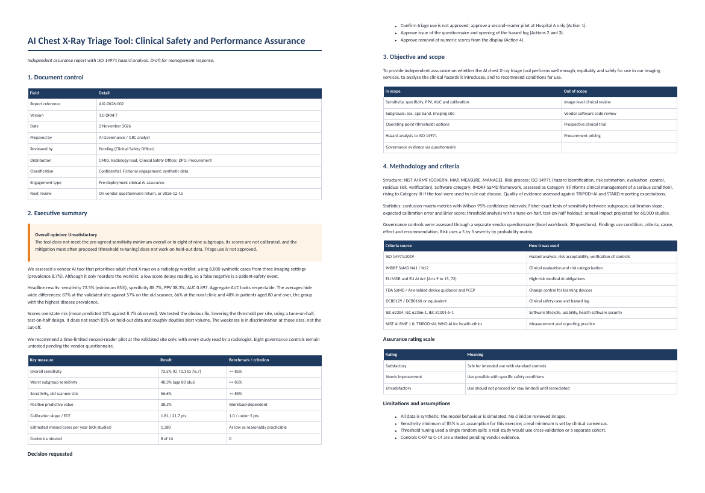
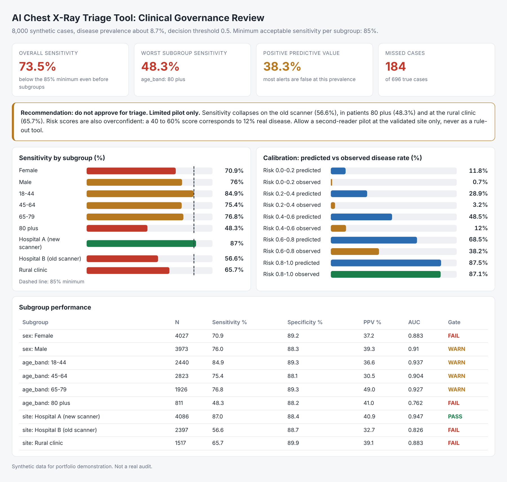

# AI Diagnostic Tool: Clinical Safety and Performance Assurance

A clinical-safety assurance of an AI chest X-ray triage tool: validation statistics, ISO 14971 hazard analysis, a report with a clinical safety opinion, and a vendor questionnaire.



> All data, vendors, companies and schools are **synthetic or fictional**. The method, instruments and code are real and reproducible. Findings describe the simulated systems, not real products.

## How a GRC specialist approaches this

| Step | What was done |
|---|---|
| Overall approach | Pre-deployment clinical safety assurance with an ISO 14971 hazard log (severity x probability, controls, residual risk) and an audit-style report. |
| Frameworks | ISO 14971; IMDRF SaMD risk categorisation; EU MDR and EU AI Act; FDA SaMD and PCCP; DCB0129/0160 clinical safety; IEC 62304 / 62366-1 / 81001-5-1; NIST AI RMF; TRIPOD+AI. |
| Quantitative tests | Sensitivity and specificity with Wilson CIs, subgroup Fisher tests, calibration slope / ECE / Brier, tune-on-half test-on-half threshold analysis, annual impact projection. |
| Governance tests | 30-question clinical AI due-diligence questionnaire (regulatory status, clinical evidence, human factors, security, PMS and change control). |

## Result

- **Opinion: Unsatisfactory for triage.** Overall sensitivity 73.5% (CI 70.1 to 76.7) against an 85% minimum; 8 of 9 subgroups are below it. The old-scanner site is at 56.6%, the rural clinic 65.7%, patients 80 and over 48.3%.
- Scores are not probabilities: mean predicted risk is about 3.5 times observed prevalence (calibration slope 1.81, ECE 21.7 points).
- **The obvious fix fails.** Retuning thresholds per site reaches only 77 to 78% sensitivity on held-out data while alert volume roughly doubles or more. The weakness is discrimination at those sites, not the cut-off.
- At 60,000 studies a year about 1,380 true cases would not be flagged. Recommendation: second-reader pilot at the validated site only.

### Summary dashboard (appendix view)



## Deliverables

| File | Purpose |
|---|---|
| `docs/AI_Diagnostic_Tool_Clinical_Assurance_Report.pdf` | Clinical assurance report (also .docx and .md) |
| `docs/clinical_ai_vendor_due_diligence_questionnaire.xlsx` | Separate vendor questionnaire |
| `analysis.py` | Simulated case data |
| `audit.py` | Validation statistics engine |
| `build_report.py` | Builds report, hazard log and questionnaire |
| `docs/dashboard.png` | First-pass summary dashboard (appendix view) |

## Reproduce

```bash
pip install -r requirements.txt
python3 analysis.py && python3 audit.py && python3 build_report.py
```
PDF export needs Node with Playwright (`npx playwright install chromium`). Workbook verification in project 6 needs LibreOffice.

## Limits

Synthetic data and simulated systems. Thresholds and weights are stated assumptions shown in the code so they can be challenged. This is not legal, clinical or financial advice, and governance controls that need vendor evidence are marked NOT TESTED in the report rather than assumed.
