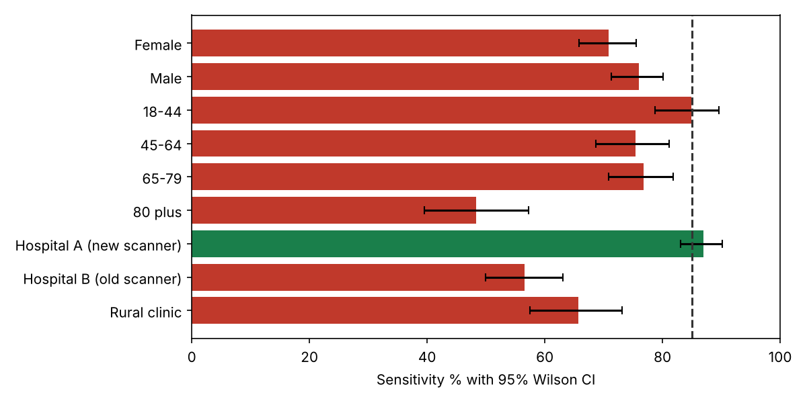
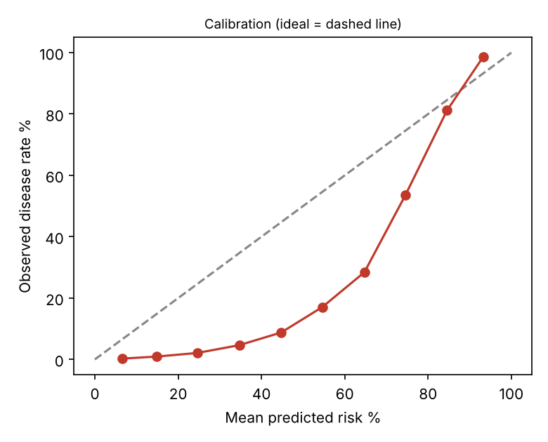

# AI Chest X-Ray Triage Tool: Clinical Safety and Performance Assurance
*Independent assurance report with ISO 14971 hazard analysis. Draft for management response.*

## 1. Document control

| Field | Detail |
|---|---|
| Report reference | AIG-2026-002 |
| Version | 1.0 DRAFT |
| Date | 2 November 2026 |
| Prepared by | AI Governance / GRC analyst |
| Reviewed by | Pending (Clinical Safety Officer) |
| Distribution | CMIO, Radiology lead, Clinical Safety Officer, DPO, Procurement |
| Classification | Confidential. Fictional engagement; synthetic data. |
| Engagement type | Pre-deployment clinical AI assurance |
| Next review | On vendor questionnaire return, or 2026-12-15 |

## 2. Executive summary

> **Overall opinion: Unsatisfactory**  
> The tool does not meet the pre-agreed sensitivity minimum overall or in eight of nine subgroups, its scores are not calibrated, and the mitigation most often proposed (threshold re-tuning) does not work on held-out data. Triage use is not approved.

We assessed a vendor AI tool that prioritises adult chest X-rays on a radiology worklist, using 8,000 synthetic cases from three imaging settings (prevalence 8.7%). Although it only reorders the worklist, a low score delays reading, so a false negative is a patient-safety event.

Headline results: sensitivity 73.5% (minimum 85%), specificity 88.7%, PPV 38.3%, AUC 0.897. Aggregate AUC looks respectable. The averages hide wide differences: 87% at the validated site against 57% on the old scanner, 66% at the rural clinic and 48% in patients aged 80 and over, the group with the highest disease prevalence.

Scores overstate risk (mean predicted 30% against 8.7% observed). We tested the obvious fix, lowering the threshold per site, using a tune-on-half, test-on-half design. It does not reach 85% on held-out data and roughly doubles alert volume. The weakness is in discrimination at those sites, not the cut-off.

We recommend a time-limited second-reader pilot at the validated site only, with every study read by a radiologist. Eight governance controls remain untested pending the vendor questionnaire.

| Key measure | Result | Benchmark / criterion |
|---|---|---|
| Overall sensitivity | 73.5% (CI 70.1 to 76.7) | >= 85% |
| Worst subgroup sensitivity | 48.3% (age 80 plus) | >= 85% |
| Sensitivity, old scanner site | 56.6% | >= 85% |
| Positive predictive value | 38.3% | Workload-dependent |
| Calibration slope / ECE | 1.81 / 21.7 pts | 1.0 / under 5 pts |
| Estimated missed cases per year (60k studies) | 1,380 | As low as reasonably practicable |
| Controls untested | 8 of 14 | 0 |

### Decision requested

- Confirm triage use is not approved; approve a second-reader pilot at Hospital A only (Action 1).
- Approve issue of the questionnaire and opening of the hazard log (Actions 2 and 3).
- Approve removal of numeric scores from the display (Action 4).

## 3. Objective and scope

To provide independent assurance on whether the AI chest X-ray triage tool performs well enough, equitably and safely for use in our imaging services, to analyse the clinical hazards it introduces, and to recommend conditions for use.

| In scope | Out of scope |
|---|---|
| Sensitivity, specificity, PPV, AUC and calibration | Image-level clinical review |
| Subgroups: sex, age band, imaging site | Vendor software code review |
| Operating-point (threshold) options | Prospective clinical trial |
| Hazard analysis to ISO 14971 | Procurement pricing |
| Governance evidence via questionnaire |  |

## 4. Methodology and criteria

Structure: NIST AI RMF (GOVERN, MAP, MEASURE, MANAGE). Risk process: ISO 14971 (hazard identification, risk estimation, evaluation, control, residual risk, verification). Software category: IMDRF SaMD framework, assessed as Category II (informs clinical management of a serious condition), rising to Category III if the tool were used to rule out disease. Quality of evidence assessed against TRIPOD+AI and STARD reporting expectations.

Statistics: confusion-matrix metrics with Wilson 95% confidence intervals; Fisher exact tests of sensitivity between subgroups; calibration slope, expected calibration error and Brier score; threshold analysis with a tune-on-half, test-on-half holdout; annual impact projected for 60,000 studies.

Governance controls were assessed through a separate vendor questionnaire (Excel workbook, 30 questions). Findings use condition, criteria, cause, effect and recommendation. Risk uses a 5 by 5 severity by probability matrix.

| Criteria source | How it was used |
|---|---|
| ISO 14971:2019 | Hazard analysis, risk acceptability, verification of controls |
| IMDRF SaMD N41 / N12 | Clinical evaluation and risk categorisation |
| EU MDR and EU AI Act (Arts 9 to 15, 72) | High-risk medical AI obligations |
| FDA SaMD / AI-enabled device guidance and PCCP | Change control for learning devices |
| DCB0129 / DCB0160 or equivalent | Clinical safety case and hazard log |
| IEC 62304, IEC 62366-1, IEC 81001-5-1 | Software lifecycle, usability, health software security |
| NIST AI RMF 1.0; TRIPOD+AI; WHO AI for health ethics | Measurement and reporting practice |

### Assurance rating scale

| Rating | Meaning |
|---|---|
| Satisfactory | Safe for intended use with standard controls |
| Needs improvement | Use possible with specific safety conditions |
| Unsatisfactory | Use should not proceed (or stay limited) until remediated |

### Limitations and assumptions

- All data is synthetic; the model behaviour is simulated. No clinician reviewed images.
- Sensitivity minimum of 85% is an assumption for this exercise; a real minimum is set by clinical consensus.
- Threshold tuning used a single random split; a real study would use cross-validation or a separate cohort.
- Controls C-07 to C-14 are untested pending vendor evidence.

## 5. Results of control testing

Each control objective was tested against the stated criteria. Results are PASS, PARTIAL or FAIL, with the test performed and the evidence relied on.

| Ref | Control objective | Test performed | Result | Evidence / finding |
|---|---|---|---|---|
| C-01 | Overall sensitivity at least 85% | Confusion matrix at vendor threshold, Wilson CI | FAIL | 73.5% (CI 70.1 to 76.7) |
| C-02 | Sensitivity at least 85% in each subgroup | 9 subgroups (sex, age, site) | FAIL | 8 of 9 below |
| C-03 | No clinically important disparity across settings | Fisher exact tests vs reference | FAIL | Hospital B p < 0.001; age 80 plus p < 0.001 |
| C-04 | Scores calibrated if shown as risk | Calibration slope, ECE, Brier | FAIL | ECE 21.7 pts, slope 1.81 |
| C-05 | Alert burden acceptable | PPV, alert rate, annual volume | PARTIAL | PPV 38.3%, ~9,998 flags/yr |
| C-06 | Local re-tuning can meet the minimum | Tune-on-half, test-on-half | FAIL | Held-out sensitivity 77 to 78% at weak sites |
| C-07 | Regulatory status matches intended use (FDA / CE) | Questionnaire section 1 | NOT TESTED | Awaiting vendor response (F6) |
| C-08 | Prospective or external clinical validation | Questionnaire section 2 | NOT TESTED | Awaiting vendor response (F6) |
| C-09 | Human factors and automation-bias study | Questionnaire section 5 | NOT TESTED | Awaiting vendor response (F6) |
| C-10 | Cybersecurity and SBOM | Questionnaire section 6 | NOT TESTED | Awaiting vendor response (F6) |
| C-11 | Post-market surveillance and drift monitoring | Questionnaire section 7 | NOT TESTED | Awaiting vendor response (F6) |
| C-12 | Change control and predetermined change plan | Questionnaire section 7 | NOT TESTED | Awaiting vendor response (F6) |
| C-13 | Data protection, retention and secondary use | Questionnaire section 6 | NOT TESTED | Awaiting vendor response (F6) |
| C-14 | Clinical safety case and hazard log ownership | Questionnaire section 5 | NOT TESTED | Awaiting vendor response (F6) |

*Figure 1. Sensitivity by subgroup with 95% Wilson confidence intervals (dashed line: 85% minimum)*

*Figure 2. Calibration: predicted versus observed disease rate*

## 6. Detailed findings

### F1  Sensitivity is below the 85% minimum overall and in most subgroups  [Critical]

| Field | Detail |
|---|---|
| **Rating** | Critical |
| **Condition (what we found)** | At the vendor's threshold (0.5), overall sensitivity is 73.5% (95% CI 70.1 to 76.7); 8 of 9 subgroups are below 85%. At 60,000 studies a year this equates to about 1,380 true cases not flagged. |
| **Criteria (what should be)** | Pre-agreed clinical performance minimum of 85% sensitivity (set by the clinical safety officer for a triage tool where a missed case delays reading). IMDRF SaMD clinical evaluation expects performance in the intended population. |
| **Cause** | Operating point chosen for specificity and demonstrated on a single favourable site; no subgroup performance requirement specified in procurement. |
| **Effect (risk)** | Delayed diagnosis and potential serious patient harm, concentrated in the groups below. |
| **Recommendation** | Do not approve for triage. Restrict any pilot to a second-reader role (all studies still read) until local performance meets the minimum. |
| **Framework references** | ISO 14971 7; IMDRF SaMD N41; EU MDR Annex I; EU AI Act Art 15 |
| **Owner / target** | Clinical Safety Officer / 2026-11-16 |

### F2  Performance fails on the older scanner, in rural imaging and in the oldest patients  [Critical]

| Field | Detail |
|---|---|
| **Rating** | Critical |
| **Condition (what we found)** | Sensitivity: Hospital A 87.0%; Hospital B (old scanner) 56.6% (p < 0.001 vs A); rural clinic 65.7% (p < 0.001); age 80 plus 48.3% versus 84.9% for 18 to 44 (p < 0.001). Sex difference (70.9% v 76.0%) is not significant (p = 0.144). |
| **Criteria (what should be)** | Performance must be demonstrated and acceptable in each clinically relevant subgroup and imaging setting in the intended use population (EU AI Act Art 10(2) and 15; MDR clinical evaluation; WHO guidance on AI for health). |
| **Cause** | Dataset shift: the model degrades on image characteristics unlike its training data (scanner, acquisition protocol). The 80 plus group also has the highest disease prevalence, so the tool is weakest where need is greatest. |
| **Effect (risk)** | Inequity of care: the sites and patients with least radiology capacity receive the least reliable support. |
| **Recommendation** | Restrict use to the validated scanner class. Require vendor to provide subgroup validation and a fine-tuning plan using local data for other sites, followed by re-validation. |
| **Framework references** | NIST AI RMF MEASURE 2.11, MAP 2.3; ISO 14971 5.5 |
| **Owner / target** | CMIO / Vendor / 2026-12-15 |

### F3  Risk scores are not probabilities and must not be displayed as percentages  [High]

| Field | Detail |
|---|---|
| **Rating** | High |
| **Condition (what we found)** | Mean predicted risk is 30.3% against an observed prevalence of 8.7%. Expected calibration error 21.7 points; calibration slope 1.81 (ideal 1.0); Brier score 0.109. A score band of 0.4 to 0.6 corresponds to about 9% observed disease. |
| **Criteria (what should be)** | Where a probability is displayed it must be calibrated (TRIPOD+AI reporting; NIST MEASURE 2.5). |
| **Cause** | Model trained for ranking, not calibrated to deployment prevalence. |
| **Effect (risk)** | Clinicians reading a number as a probability will over-estimate risk in most cases and mis-prioritise. |
| **Recommendation** | Show a coarse flag only; or recalibrate on local data and re-validate before displaying any numeric risk. |
| **Framework references** | TRIPOD+AI; NIST AI RMF MEASURE 2.5 |
| **Owner / target** | Vendor / CMIO / 2026-12-15 |

### F4  Re-tuning the threshold per site does not restore safe performance  [High]

| Field | Detail |
|---|---|
| **Rating** | High |
| **Condition (what we found)** | Thresholds were tuned on half of each group's data to reach 85% sensitivity and evaluated on the other half. Result on held-out data: Hospital B (old scanner): 78% sensitivity at threshold 0.33, PPV 18%, alerts on 35% of studies; Rural clinic: 78% sensitivity at threshold 0.38, PPV 24%, alerts on 30% of studies; Age 80 plus: 77% sensitivity at threshold 0.26, PPV 20%, alerts on 53% of studies. None reach 85% on held-out data, and alert volume rises sharply. |
| **Criteria (what should be)** | Mitigations must be shown to be effective on data not used to design them (ISO 14971 7.2 verification of risk control effectiveness). |
| **Cause** | The problem is weak discrimination (AUC) at those sites, not the cut-off. Lowering the threshold buys sensitivity with false positives, not with better signal. |
| **Effect (risk)** | A tempting quick fix would add workload and still leave patients under-served. |
| **Recommendation** | Do not rely on threshold changes. Require fine-tuning on local images with prospective re-validation. |
| **Framework references** | ISO 14971 7.2; IMDRF SaMD N41 |
| **Owner / target** | Vendor / Radiology lead / 2027-01-31 |

### F5  Alert burden is high and most alerts are false positives  [Medium]

| Field | Detail |
|---|---|
| **Rating** | Medium |
| **Condition (what we found)** | At prevalence 8.7% the PPV is 38.3% and 16.7% of studies are flagged (about 9,998 per year at 60,000 studies). |
| **Criteria (what should be)** | Workflow impact is assessed and acceptable (human factors, IEC 62366-1). |
| **Cause** | Moderate specificity at low prevalence. |
| **Effect (risk)** | Alert fatigue, ignored flags, slower worklist. |
| **Recommendation** | Pilot with measured workload and override rates; define tolerance and stop rules. |
| **Framework references** | IEC 62366-1; NIST MEASURE 2.8 |
| **Owner / target** | Radiology lead / 2027-02-28 |

### F6  Clinical safety governance evidence is missing  [High]

| Field | Detail |
|---|---|
| **Rating** | High |
| **Condition (what we found)** | Eight control objectives (C-07 to C-14) are untested: no regulatory clearance mapping, no prospective validation, no human factors study, no cybersecurity assessment, no post-market surveillance plan, no change-control (PCCP) and no hazard log owner. |
| **Criteria (what should be)** | DCB0129/DCB0160 (UK) or equivalent clinical safety standard; MDR; EU AI Act Arts 9, 14, 72; FDA predetermined change control guidance. |
| **Cause** | Procurement proceeded on a vendor demonstration. |
| **Effect (risk)** | Unquantified patient-safety and regulatory exposure. |
| **Recommendation** | Vendor to return the clinical AI due-diligence questionnaire (workbook provided); clinical safety officer to maintain the hazard log and safety case. |
| **Framework references** | ISO 14971; IEC 62304; IEC 81001-5-1 |
| **Owner / target** | Clinical Safety Officer / 2026-11-30 |

## 7. Risk assessment

Hazards follow ISO 14971: impact is harm severity (1 negligible to 5 catastrophic) and likelihood is probability of the harm occurring (1 improbable to 5 frequent). Inherent assumes no controls; residual assumes the proposed controls are implemented and verified.

| ID | Risk | Inherent | Existing controls | Residual | Owner | Treatment |
|---|---|---|---|---|---|---|
| H1 | False negative deprioritises a true case; reading delayed | 4x5=20 (Critical) | None at present | 2x5=10 (Medium) | Clinical Safety Officer | Read-all-studies policy; restrict to validated scanner; sample audit of unflagged |
| H2 | Radiologist over-trusts a negative flag (automation bias) | 3x5=15 (High) | None at present | 2x5=10 (Medium) | Radiology lead | Training; blinded-read audits; no 'normal' label shown |
| H3 | Scanner or protocol upgrade silently changes performance | 4x4=16 (High) | None at present | 2x4=8 (Medium) | Imaging physicist | Change log from imaging team; revalidate before use on new equipment |
| H4 | Numeric score misread as probability | 4x4=16 (High) | None at present | 1x4=4 (Low) | CMIO | Remove numeric display; coarse flag only |
| H5 | Inequitable performance in 80 plus and rural patients | 4x4=16 (High) | None at present | 2x4=8 (Medium) | CMIO | Scope exclusion until validated; subgroup monitoring |
| H6 | Alert fatigue leads to ignored flags | 4x3=12 (High) | None at present | 3x3=9 (Medium) | Radiology lead | Workload metrics; override-rate stop rules |
| H7 | Unvalidated vendor model update deployed | 3x4=12 (High) | None at present | 1x4=4 (Low) | Procurement | Contractual change notice; revalidation gate |
| H8 | Image data used for vendor training without basis | 3x4=12 (High) | None at present | 1x4=4 (Low) | DPO | DPA prohibiting secondary use; DPIA |

## 8. Recommendations and action plan

| # | Action | Addresses | Priority | Owner | Target date |
|---|---|---|---|---|---|
| 1 | Record decision: no triage use; second-reader pilot at Hospital A only | F1 F2 | Immediate | Clinical Safety Officer | 2026-11-09 |
| 2 | Issue clinical AI due-diligence questionnaire; collect evidence | F6 | High | Procurement / CMIO | 2026-11-30 |
| 3 | Open hazard log and clinical safety case; name hazard owners | F6 | High | Clinical Safety Officer | 2026-11-30 |
| 4 | Remove numeric score display; show coarse flag | F3 | High | CMIO | 2026-12-15 |
| 5 | Vendor to supply subgroup validation and a local fine-tuning plan; re-validate prospectively | F2 F4 | High | Vendor / Radiology lead | 2027-01-31 |
| 6 | Run pilot with read-all policy, 5% blinded re-read of unflagged studies, workload and override metrics | F1 F5 | Medium | Radiology lead | 2027-02-28 |
| 7 | Embed monitoring plan with stop rules (appendix B) in contract and local procedure | H3 H6 H7 | Medium | Clinical Safety Officer | 2027-03-31 |

## 9. Management response

Responses below are drafted for the accountable owner to confirm, amend or reject. An accepted risk requires a named executive signature and an expiry date.

| Finding | Proposed response | Accept / Amend / Reject | Owner sign-off |
|---|---|---|---|
| F1 | Agree. Triage use not approved. | Pending | Pending |
| F2 | Agree. Scope restricted to Hospital A. | Pending | Pending |
| F3 | Agree. Numeric display disabled. | Pending | Pending |
| F4 | Agree. Threshold re-tuning removed from the mitigation plan. | Pending | Pending |
| F5 | Agree. | Pending | Pending |
| F6 | Agree. | Pending | Pending |

## 10. Appendices

### Appendix A. Subgroup performance

| Subgroup | N | Sens % | 95% CI | Spec % | PPV % | AUC |
|---|---|---|---|---|---|---|
| sex: Female | 4027 | 70.9 | 65.8 to 75.5 | 89.2 | 37.2 | 0.883 |
| sex: Male | 3973 | 76.0 | 71.3 to 80.1 | 88.3 | 39.3 | 0.910 |
| age_band: 18-44 | 2440 | 84.9 | 78.7 to 89.6 | 89.3 | 36.6 | 0.937 |
| age_band: 45-64 | 2823 | 75.4 | 68.7 to 81.1 | 88.1 | 30.5 | 0.904 |
| age_band: 65-79 | 1926 | 76.8 | 70.9 to 81.8 | 89.3 | 49.0 | 0.927 |
| age_band: 80 plus | 811 | 48.3 | 39.5 to 57.2 | 88.2 | 41.0 | 0.762 |
| site: Hospital A (new scanner) | 4086 | 87.0 | 83.0 to 90.1 | 88.4 | 40.9 | 0.947 |
| site: Hospital B (old scanner) | 2397 | 56.6 | 49.9 to 63.1 | 88.7 | 32.7 | 0.826 |
| site: Rural clinic | 1517 | 65.7 | 57.4 to 73.1 | 89.9 | 39.1 | 0.883 |

### Appendix B. Monitoring plan and stop rules

| Signal | Method | Frequency | Stop trigger |
|---|---|---|---|
| Sensitivity | Blinded re-read of 5% of unflagged studies | Monthly | Estimate below 85% |
| Subgroup sensitivity | Stratified by site, age, sex | Quarterly | Any subgroup below 80% |
| Alert rate | Share of studies flagged | Weekly | Moves more than 20% from baseline |
| PPV | Flags confirmed | Monthly | Below 25% |
| Override rate | Radiologist disagrees | Monthly | Over 40% or near 0% |
| Equipment change | Imaging change log | Event | Revalidate before use |

### Appendix C. Threshold re-tuning on held-out data

| Group | Threshold | Held-out sens at 0.5 | Held-out sens tuned | Tuned PPV | Tuned alert rate |
|---|---|---|---|---|---|
| Hospital A (new scanner) | 0.50 | 88.9 | 88.9 | 40.0 | 18.0 |
| Hospital B (old scanner) | 0.33 | 49.5 | 78.2 | 18.2 | 35.5 |
| Rural clinic | 0.38 | 69.1 | 77.9 | 23.9 | 29.9 |
| Age 80 plus | 0.26 | 36.8 | 77.2 | 20.1 | 53.2 |

### Appendix D. Companion documents

docs/clinical_ai_vendor_due_diligence_questionnaire.xlsx; data/cases.csv; analysis.py (simulation) and audit.py (statistics); data/clinical_stats.json.
